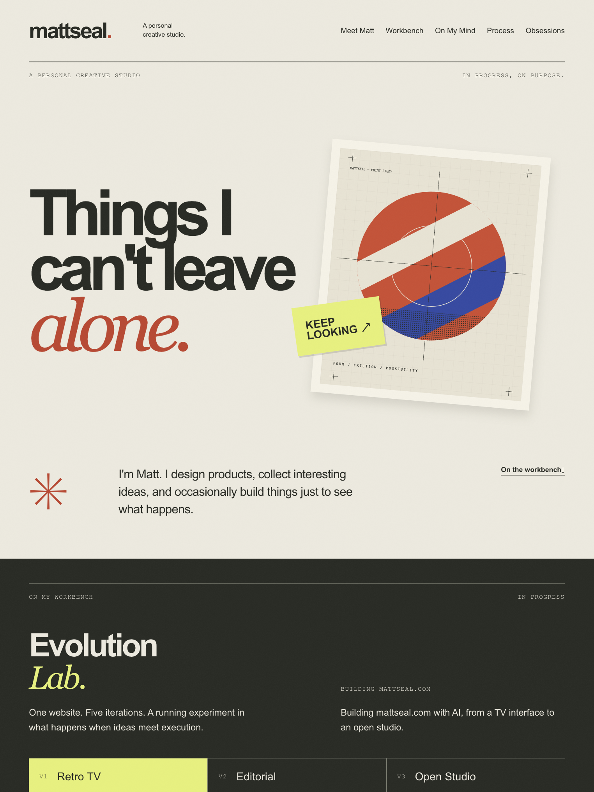

# mattseal

**A personal creative studio for design, technology, culture, and things I can't leave alone.**



mattseal.com is an experimental personal website by Matthew Kearney, a product designer exploring design, technology, creative coding, and personal expression.

Professional work lives at [sealspace.com](https://sealspace.com/). This studio is a space for curiosity, thinking, work in progress, and creative interests.

## Creative Direction

Expressive typography, warm paper textures, bold original graphics, asymmetrical compositions, and restrained analog details. The visual sensibility draws on editorial design, while the experience centers on a person and their creative process.

Keep the established hero and its mobile composition. Colors and typography retain the established visual identity. Meaningful content should determine interactions; decorative technical demonstrations are not a goal.

## Studio Structure

- **Meet Matt:** The existing hero and introduction, with a personal sign-off and professional-work link.
- **On My Workbench:** An Evolution Lab exploring the real V1 Retro TV, V2 Editorial, and V3 Open Studio milestones, with genuine screenshots, interactive local archives, design commentary, and source links.
- **Things on My Mind:** Matt's supplied perspective that as AI makes building easier, judgment about what deserves to exist becomes more important.
- **Behind the Scenes:** A compact note until genuine process documentation is available.
- **Current Obsessions:** [rectangles.fm](https://rectangles.fm/) and [My 80s TV](https://80s.theretrotvs.com/) as references for analog-inspired digital creativity. My 80s TV is a featured discovery with an optional live iframe and an attributed screenshot fallback; rectangles.fm remains a smaller supporting link. The TV interface is not rebuilt.

Personal commentary follows Matt's supplied perspectives and approved wording. Historical versions preserve their original content.

## Built With

HTML, CSS, and vanilla JavaScript, developed with an AI-assisted workflow using Cursor and OpenAI Codex. Version control uses Git and GitHub. No framework, CMS, package installation, or build step is required.

## Getting Started

```bash
git clone https://github.com/sealrockswell/mattseal.git
cd mattseal
```

Run this local-only HTTP server from the project folder (Python 3 required). HTTP serving is required to preview the archive directory links correctly:

```bash
python3 -m http.server 8000 --bind 127.0.0.1
```

Visit http://127.0.0.1:8000. Stop the server with Ctrl+C.

## Project Files

- `index.html` — Semantic studio sections, approved commentary, and native anchor navigation.
- `styles.css` — Design tokens, responsive hero, varied studio layouts, focus treatments, and reduced-motion support.
- `main.js` — Accessible Evolution Lab tabs and an opt-in external TV iframe. Without JavaScript, all milestones and the TV screenshot/new-tab launch link remain available.
- `assets/` — Original local SVG print artwork, paper grain, and favicon. Initial content uses local assets; loading the TV explicitly requests the external site and its media.

The current homepage does not use the former print-reveal slider. Its original controls, scripts, and artwork remain fully functional in the preserved V2 website at `/archive/v2/`, available through Evolution Lab and as a standalone page.

## Iteration and Review

Edit copy in `index.html`. Tune color and font tokens at the top of `styles.css`. Keep new behavior optional and useful to the content. Use clearly labeled placeholders where genuine material is not yet available.

Review at **390px, 768px, and 1440px**:

- Check horizontal overflow, readable text, artwork containment, and unintended overlaps.
- Tab through the skip link, navigation, and content links; verify visible focus and logical order.
- Check internal destinations and accessible section names.
- Disable JavaScript: all content and navigation should remain functional.
- Enable reduced motion: scrolling should be immediate.
- Review on physical touch devices and in Safari and Firefox before launch.

## Design Principles

1. **Personality over convention.** Make the experience feel authored, not templated.
2. **Experiment with purpose.** Interactions should create delight or meaning, not unnecessary friction.
3. **Analog character, digital precision.** Embrace texture and imperfection without sacrificing usability.
4. **Content is the experience.** Ideas, perspectives, and experiments should drive the design.
5. **Always evolving.** Treat the website as a living creative project rather than a finished artifact.

## Project Status

**V6 content and launch polish / Local review**

The studio structure is implemented. Genuine process documentation remains to be selected and added. There are no invented finished experiments, personal stories, achievements, or videos. No CMS, analytics, deployment configuration, or domain connection is included.

## About

Created by **Matthew Kearney**.

Professional work: [sealspace.com](https://sealspace.com/)\
LinkedIn: [Matthew Kearney](https://www.linkedin.com/in/matthewkearneydesign)

---

*Made for the things that don't fit neatly into a portfolio.*

## Evolution Lab and Screenshot Provenance

The lab starts on V1. Use Left/Right arrows, Home/End, Enter, or Space to select a version. Tab moves from the selected tab into its panel and source link. Direct milestone anchors also select the appropriate panel. All panels are visible without JavaScript. Selection is immediate, with no animation.

Screenshots were captured on 2026-10-23 in Chrome at 1440px wide from isolated, unmodified exports of the saved tags, framing their defining sections. V1 and V2 are 1440 × 1000; V3 is 1440 × 753, fitted to the complete workbench section without a cut-off neighboring section. Captures are compressed WebP with explicit dimensions and lazy loading. Historical tags and the archive branch were not changed.

| Asset | Source |
|---|---|
| `assets/v1-retro-tv.webp` | `v1-retro-tv`, commit `36882a9`, TV section |
| `assets/v2-editorial.webp` | `v2-editorial`, commit `bcf63e0`, print-study section |
| `assets/v3-open-studio.webp` | `v3-open-studio`, commit `0b29b6e`, workbench section |
| `assets/my-80s-tv.webp` | Actual capture of https://80s.theretrotvs.com/, initial TV interface; no playback embedded |

The GitHub repository is public (verified before V4). Milestone links open their saved source tags in a new tab. This implementation does not change visibility.

The external screenshot is a preview of My 80s TV, not original mattseal artwork. Its screenshot remains the fallback when the live TV is closed, JavaScript is unavailable, or the viewport is unsuitable for the embedded controls. Its presentation can be replaced independently of the hero and lab. No fabricated screenshots or missing preview placeholders are used.

## Live My 80s TV: Feasibility and Behavior

Checked on 2026-10-23: the final HTTPS response returned 200 with no `X-Frame-Options` or `Content-Security-Policy` header. No meta CSP was present. Actual embedding from a localhost parent rendered successfully in Chrome; `Access-Control-Allow-Origin: *` is not the basis for iframe permission. Recheck the framing policy before a future launch; the external owner can change it.

- The player loads only after **Watch here**. Before that, no iframe exists. The iframe has an accessible title, lazy loading, and delegated autoplay/fullscreen/picture-in-picture permissions. Delegation does not guarantee autoplay; browser policy and user activation still apply. The source controls playback and may restore prior state.
- Desktop (viewport ≥1100px): the live feature expands to full content width, with a 1.44:1 frame matching the verified interface proportions. It is not rotated, cropped, scaled with CSS, or covered by a custom control layer.
- Phones: testing at 390px found a dedicated 44px-high remote, and emulated power/channel taps worked. However, inside mattseal’s actual 346px content width, the external document measured 398px wide and introduced nested scrolling. The final implementation therefore uses the screenshot plus new-tab launch on phones, rather than shipping that compromise. Physical iOS/Android behavior on the original site remains to be checked.
- All widths below 1100px, including 768px: retain the authentic screenshot and **Open My 80s TV** link. The external desktop controls measured only about 12px high at 768px, so embedding there is not a comfortable touch experience.
- **Open My 80s TV** always opens a new tab. **Close TV** removes the iframe (ending its media), restores the preview, and returns keyboard focus. Resizing into the unsupported range also unloads it.
- The external document includes additional text beneath its TV. Native scrolling inside the frame remains available; no attempt is made to hide its content or manipulate its cross-origin DOM. The initial TV controls fit without internal scrolling in the tested desktop embed. Some offscreen content in the external document still increases its scroll dimensions; mattseal does not conceal or alter it.
- Cross-origin restrictions prevent mattseal from reading player state, resizing to internal content, styling internal focus, or detecting every blocked/media-error state. No proxy or workaround is used. The launch link remains available if embedding or playback fails.
- Sound audibility, actual fullscreen/picture-in-picture transitions, Safari/Firefox, physical-device gestures, and third-party cookie/media restrictions still need device testing. Fullscreen permission availability was verified in Chrome, not a successful fullscreen session.
- Mattseal respects reduced motion. It cannot force the external website or video content to honor that preference; the player is opt-in and can be closed.

## V4 TV Action Hierarchy

On desktop, **Watch here** is the primary filled button. **Open My 80s TV** is a secondary text link that opens the original site in a new tab. Once active, the inline activation button is hidden; the live toolbar provides **Close TV**, while the external link remains available. On mobile/tablet, only the prominent full-experience link and authentic screenshot are offered.

Close TV calls `iframe.remove()` and clears the reference, rather than hiding a playing frame. It restores the preview and returns focus to the inline activation button. Resizing into the fallback range also removes the iframe. Removing the browsing context prevents its playback from continuing in the background; a separately opened external tab remains independent.


## Interactive Historical Archive

The current Evolution Lab offers **Explore V1/V2/V3 here** on desktop (1100px and wider) and a prominent **Open V1/V2/V3 full page** at every width. The full websites are hosted locally at `/archive/v1/`, `/archive/v2/`, and `/archive/v3/`. GitHub links are secondary public source references.

Use a local HTTP server (`python3 -m http.server 8000`) and open http://localhost:8000/; archive directory URLs need HTTP serving. Each archive owns its HTML, styles, scripts, and assets independently of the current homepage.

- V1 comes from `v1-retro-tv` (`36882a9`), including channel and power controls.
- V2 comes from `v2-editorial` (`bcf63e0`), including the original print-reveal slider.
- V3 comes from `v3-open-studio` (`0b29b6e`), including section navigation.
- `archive/manifest.json` records full commit IDs and original/archived SHA-256 hashes. V2 and V3 runtime files are byte-for-byte copies. V1's only source adjustment replaces its remote Google Fonts import with `assets/fonts.css`. Original font families/weights are bundled as data URLs so they also load in an opaque-origin sandbox, with their OFL licenses alongside them. No design, copy, or interaction was rewritten. Repository-only `.gitignore` and historical README files are omitted.

Previews are opt-in sandboxed iframes with scripts and new-tab links allowed, but no same-origin access or top-level navigation. Close, version switching, and resizing below 1100px remove the previous iframe. Only one archive frame can exist. The independent My 80s TV player is unchanged. Full versions open in their own tabs, without the preview sandbox.

Screenshots remain the initial and closed states. Without JavaScript, all three screenshots, descriptions, decisions, and full-version/source links are visible. On phones/tablets the full-version link avoids a cramped nested viewport. Desktop previews retain native vertical scrolling to keep every historical section reachable; Open full version removes that constraint. A load event confirms document navigation, not every possible network/browser error; the full-version link stays available.

Historical limitations are intentionally preserved, including original copy and control sizes. No new animation was added. Historical reduced-motion rules remain intact. Physical-device and Safari/Firefox testing remain follow-up work.

Validated in local Chrome on 2026-10-24 at 390px, 768px, and 1440px: all standalone versions fit horizontally, images load, and internal anchor targets exist. V1 channel/power controls, V2 keyboard slider, and V3 navigation passed. All three sandboxed previews passed their original interaction checks; switching, closing, and narrowing the viewport remove the iframe. Homepage keyboard selection/focus, reduced motion, no-JavaScript content, and existing My 80s TV activation/removal checks passed. These are browser/emulation checks, not physical-device certification.


## V6 Preview and Future Production Verification

- `assets/social-preview.png` is a 1200 × 630 static composition of the existing masthead, headline, and original `assets/overprint.svg` artwork. The homepage declares canonical and social URLs under `https://mattseal.com/`. These production URLs are intentional; they are not a claim that this iteration has been deployed.
- Serve the repository root as static files, including the complete `archive/` directories. Directory-index requests such as `/archive/v2/` must serve that directory's `index.html`. Do not rewrite archive requests to the current homepage.
- Keep nested relative paths intact: archived `styles.css`, `main.js`, and `assets/` resolve inside their own version directories. Check direct entry and refresh at all three archive URLs on the future host, alongside homepage full-page links and sandboxed previews.
- Before launch, verify HTTPS, canonical redirects, correct HTML/CSS/JS/SVG/PNG MIME types, social preview availability at its absolute URL, and real sharing-card rendering. Recheck third-party framing permissions and playback. Choose compression/cache and security headers only after testing them against the historical scripts and external TV; no hosting provider or deployment settings are selected here.
- Repeat 390/768/1440px keyboard, focus, no-JavaScript, reduced-motion, overflow, image, archive, and TV checks. Safari, Firefox, physical touch devices, and screen-reader testing remain outstanding.
- V6 leaves historical builds, their checksum manifest, tags, and archive branches unchanged. The homepage's five-iteration introduction describes the evolution through V5; the interactive historical selector intentionally offers V1–V3 only.
